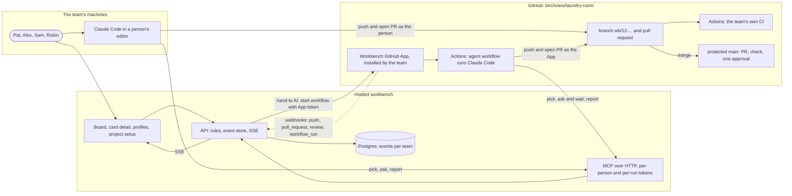

# The development loop on a hosted workbench

As of 2026-11-11, written by Claude at Mikael's request. **This is a vision, not a decision.** It shows what the development loop in `docs/dev-loop.md` would look like when the workbench is deployed as a service, and a team registers its own project and GitHub repository with it. Nothing here has been decided unless it points to `docs/decisions.md`. Where it proposes something, it says so, and the open choices are collected at the end.

The project and the people in it are the invented laundry room example from `examples/laundry-room/`. The repository name `birchview/laundry-room` is invented too.

## Why the loop changes shape

The loop in `docs/dev-loop.md` runs on Mikael's machine, on the workbench's own repository, with one person and the AI. Three things about that setup are local workarounds rather than the design, and a hosted workbench removes all three.

The first is reachability. GitHub cannot reach an API on a laptop, so webhooks travel through `gh webhook forward`, which GitHub describes as a tool for development only. It allows one forwarder per repository, and a delivery made while it is down should be treated as lost. A hosted API has a public address, and the GitHub App delivers its webhooks there directly, with GitHub's own record of each delivery and the ability to redeliver one that failed.

The second is the team of one. Mikael holds every role and cannot approve his own pull requests, so GitHub requires no approvals and the workbench alone holds the human gate. A real team has a second person for every change, so GitHub can require an approval as well, and the function's human check (for `review_pull_request`, an approver who did not write the change) becomes something the board can actually show being met.

The third is self-reference. On this repository, a merged pull request changes the code of the API that recorded it, so `team:serve` must be restarted after every merge. A registered project's repository is not the workbench, so a merge is just an event.

What stays the same is the loop itself: the six steps, the branch and pull request naming convention, the webhook mapping table, the rule that moves follow the card's mode, and the rule that a card reaches done only after a person's approval. The hosted version is the same loop with the workarounds taken out and more than one team using it.

## What the workbench is, deployed

Proposed: one deployment serves many teams. Each team has its own board, people, cycles and event stream, and each team links one or more GitHub repositories. The pieces that exist today keep their jobs.

The API (`apps/api`) and the board (`apps/web`) run on a server with a public address and a login. Storage moves from one SQLite file per team to Postgres, as `docs/architecture.md` already plans, with every event carrying its team. The process model is still read from `process/`, so every team works with the same functions and protocols; whether a team may adjust a function is an open question below.

The GitHub App becomes one App for the workbench, not one per person. `workbench-ai-muxare` was made for Mikael's repository; the hosted workbench would have a single App that a team installs on its own organisation or repositories. Installing it gives the workbench three things: webhooks from those repositories, sent straight to `POST /api/github/webhook`; installation tokens that let the AI push branches and open pull requests as `<app>[bot]`; and the right to start a workflow in the repository, which stage 4 needs.

The MCP server keeps its tools but is reached differently. Proposed: the hosted API serves MCP over HTTP itself, at an address such as `/mcp`, with a personal access token per person and a separate token per AI run. A person's Claude Code session then connects to the hosted board by adding one remote server, and the project's repository needs no workbench code at all. The stdio server in `apps/mcp` stays useful for local development of the workbench.

## Registering a project

Registering is a one-time setup, done by whoever starts the team, usually the product owner. In the laundry room team that is Robin. Proposed, in the order the screens would ask for it:

1. **Create the team.** Name it, and invite people. Each person signs in with GitHub, which replaces the `github_logins` map in `team.json`: the workbench learns a person's login from the sign-in rather than from a file. Each person gets their roles (Robin po, Sam ux, Alex fe, Pat be), recorded as `roles_changed` events as today. The AI teammate is added with the team.
2. **Connect the repository.** Robin installs the workbench's GitHub App on `birchview/laundry-room`. The workbench lists the repositories the installation covers, and Robin links one to the team. From this moment, pushes, pull requests, reviews and workflow runs on that repository arrive as webhooks.
3. **Name the structural check.** Today the webhook counts runs of a workflow named `check`, because that is this repository's workflow. A registered project has its own CI, so the team names which workflow, or which required status checks, count as the structural check. The workbench then reads the repository's branch protection through the App and shows whether `main` requires a pull request, that check and one approval. It does not change protection itself; it says what is missing and why the loop needs it.
4. **Set the profiles.** Each person chooses a mode for each function they own, or keeps the function's default. This is the profile screen that exists today. It decides what the AI may do on each person's cards, so it is the most important setting in the whole setup, and the screen should say so.
5. **Add the agent workflow, if the team wants unattended runs.** For stage 4, the workbench offers a workflow file for the repository, for example `.github/workflows/workbench-agent.yml`, that runs Claude Code on a card's branch, and asks for the model API key to be stored as a repository secret. A team that only wants people working with the AI in their own sessions skips this step.
6. **Start a cycle and add cards.** A cycle is a named window, as today. Cards are created on the board, each with a function and an owner. Whether cards can also come from GitHub Issues is an open question below.

After registration the board looks as it does today, with the board, the teammate panels, the cycle log, card detail and profiles, plus a workspace strip on each card that shows its branch, its pull request, the latest check results and the review state.

## One card through the hosted loop

Take card #12 on the laundry room board, invented: "Booking rules: a resident may hold at most two future slots", function `implement_services`, owner Pat (be). Pat works `implement_services` in `delegate`, so the AI writes and Pat decides.

**Ready.** Robin moved the card to ready during planning. The define_api_contract card it depends on is done, so nothing blocks it.

**Handed to the AI.** Pat opens the card and chooses "Hand to the AI". This is the recorded decision that step 2 of `docs/dev-loop.md` says does not exist yet; proposed, it is a card event naming who handed it over and in which mode. Because the team installed the agent workflow, the workbench uses the App's token to start that workflow in `birchview/laundry-room` for card #12, and gives the run a token that lets it act as the AI teammate on this team's board and nowhere else.

**The work.** In GitHub Actions, Claude Code starts on a fresh branch, `wb/12-booking-limit`. Through the hosted MCP server it reads the card with its function definition, the protocol for `delegate` and the linked cards, and picks the card; the API checks the same rules as today. It finds that the contract does not say whether a cancelled slot still counts towards the limit, and the protocol lets the AI ask, so it asks Pat on the card. The card moves to needs input, the board shows a dashed line from the AI to Pat, and Pat gets a notification. Pat answers on the card that cancelled slots do not count; the answer goes into the card's decision log, and the run, which has been waiting on the answer, continues. If Pat does not answer within the run's time limit, the run posts a report saying where it stopped and ends, and a later hand-over starts a new run from the branch.

**Open for review.** The run pushes the branch as the App and opens a pull request whose body says `Workbench: #12`. The webhooks arrive directly at the hosted API: `workspace_linked` and `work_pushed` on the push, then `review_requested` on the pull request. Because the card was picked in `delegate`, where the AI writes, the AI's move to review is allowed, exactly as on this repository today.

**Check.** The repository's own CI runs; its completed run reaches the card as `check_ran` with `check: "structural"`. If the team turned on the critic gate for `implement_services`, a second agent that has not seen the run reviews the pull request as the App, and its verdict arrives as `check_ran` with `check: "consistency"` on that commit. Then a person reviews. On a real team that is not necessarily the owner: Alex, who will call the booking endpoint from the frontend, requests changes because the error for a third booking has no code the UI can show. Under today's rule only the owner, or the AI where it writes, moves a card back, so Alex's review would record `changes_requested` and leave the card in review. This walk-through assumes question 9 in `docs/next.md` is answered as recommended, so that any person may send a card back: the card moves to in progress, and the AI teammate runs again on the same branch with the review as its input. A hosted team would meet that question in its first week.

**Done.** After the fix, the check passes, Pat approves, and GitHub's own rule, now one required approval, is met as well. Pat merges. The merge webhook moves card #12 to done because the latest verdict on the pull request is a person's approval on the merged head commit. The card log shows the whole story, from the hand-over through the question, the answer, the two runs, both checks and both reviews, without anyone having moved the card by hand except at the start.

**The same loop without the agent workflow.** Alex owns a card for the booking screen, `implement_interactions`, and works it in `assist`, so Alex writes and the AI asks and challenges. Alex picks the card on the board and works in their own editor with Claude Code connected to the hosted MCP server. Alex's pushes come from Alex's own GitHub account, mapped to Alex through the sign-in, and Alex opens the pull request. Sam reviews it against the UI spec and Pat against the contract. The webhooks and the gate are the same; only the hands are different. This is the case the board must make look as ordinary as the AI's, because most cards in a real team will look like this one.

## The pieces, and what each one needs

Compared with the first diagram in `docs/dev-loop.md`, the forwarder and the laptop are gone, the App is the team's rather than Mikael's, there is a second Actions workflow for the agent, and there is no dotted line from `main` back to the workbench.

## From today to there

The table lists what the hosted loop needs that does not exist today. Each line is a candidate card, not a plan.

| Today, on this repository | Hosted |
| --- | --- |
| API and board on `localhost`, no login | A public address, sign-in with GitHub, every request tied to a person and a team |
| One SQLite file per team, `teams/<id>/board.db` | Postgres, many teams, events carry their team |
| `team.json` and `cards.json` read once by `team:start` | A setup screen that records the same facts as events |
| `github_logins` in the team file | Logins from sign-in; the App's bot account mapped to the team's AI teammate |
| App `workbench-ai-muxare`, Mikael's repository only | One workbench App, installed by each team on its own repositories |
| Webhooks through `gh webhook forward`, deliveries can be lost | App webhooks to the public address, with redelivery of failed deliveries |
| The structural check is the workflow named `check` | A per-repository setting naming the workflow or required checks |
| GitHub requires no approvals; only the workbench holds the human gate | GitHub requires one approval as well; the workbench gate stays, because it also checks the head commit, the critic gate and the mode |
| MCP over stdio, started from `.mcp.json` in this repository | MCP over HTTP from the hosted API, tokens per person and per run |
| A Claude Code session started by Mikael | Stage 4: "Hand to the AI" starts the agent workflow in the team's repository |
| Restart `team:serve` after each merge | Nothing; the project's repository is not the workbench |

Stage 4 in `docs/dev-loop.md` is the bridge: it is planned for this repository, and the only part of it that changes when hosted is who starts the workflow and how its run reaches the board.

## Open choices

These are not decided, and none of them blocks the next tasks in `docs/next.md`.

Where the workbench is hosted, and who runs it. Whether one deployment serves many teams, as proposed here, or each team runs its own; the first is simpler for teams and harder for privacy. Who pays for the model when the agent runs in a team's repository; proposed here is the team's own API key as a repository secret, which keeps the workbench from holding it. Whether a team may change a function's protocols or checks, or every team uses `process/` as it is; the rule that `decides` is `human` holds either way. Whether cards can come from GitHub Issues, which `docs/dev-loop.md` also leaves open. Whether the workbench should read branch protection only, as proposed, or also be allowed to set it. How a person learns that a card waits on them when they are not looking at the board: proposed, a notification, channel not chosen. And what the learning layer (phase 5 in `docs/plan.md`) reads across teams, if anything, which depends on what teams agree to share.
