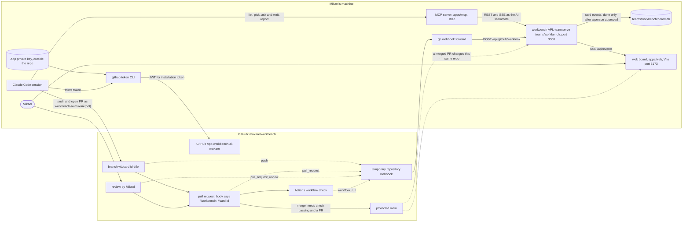
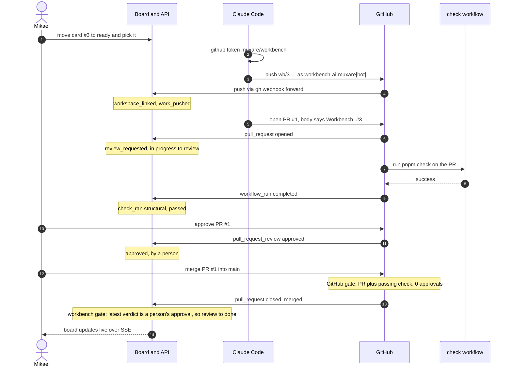

# The development loop

As of 2026-11-11. Decided with Mikael on 2026-11-09 and 2026-11-11; the decisions and their reasons are in `docs/decisions.md`. The diagram is the artifact "Workbench Development Loop" on claude.ai.

## What this adds

So far the workbench coordinates the work: who picks a card, which mode the AI works in, who is waiting on whom. It does not see the work itself. A card says "write the booking rules" but points at no branch, no pull request and no design, and nothing that happens in those places reaches the board.

The development loop closes that gap. A card is linked to the place where its work happens, a person or the AI does the work there, and the result comes back to the board as events. A card is done when a person has approved the result, not when someone says it is finished. The loop has six steps:

1. **Card is ready.** It has a function from `process/`, an owner and no unfinished `depends_on`. This exists today.
2. **Decide who does it.** A person picks the card, or someone hands it to the AI. Picking exists today; handing a card to the AI as a recorded decision does not.
3. **Do the work.** The card is linked to a branch, and a person in their editor or the AI in an agent session works on that branch.
4. **Open for review.** The work becomes a pull request, and the board learns about it from GitHub instead of from someone moving the card.
5. **Check.** The three layers from the function template run on the result: a structural check in code, an AI critic, and a person's approval. Changes requested send the card back to step 3.
6. **Done.** A card reaches done only through an approval by a person, which keeps `decides: human` true for the work as it is for the protocols.

GitHub is the first workspace because branches, pull requests and reviews already produce the events steps 3 to 5 need. Figma and documents come later, once the loop holds for code.

## The workbench is its own first project

The loop is built and tried on this repository, `muxare/workbench`, before any other project. It is the one project where Mikael can install a GitHub App, protect `main` and change how work is done without asking anyone, and the workbench needs the development anyway, so every card on its board is real work.

This makes it an unusual project, and the doc says so rather than hide it. The team is two teammates: Mikael and the AI. Mikael holds every role, product owner, designer, frontend and backend, while the model today gives each person exactly one role. A person who holds several roles is therefore the first change the model needs. The project also says little about handoffs between people, because there is only one person, which is why it does not replace the Phase 2 run on a past project with a real team.

The work on this repository is mostly building code, and until 2026-11-11 `process/` defined only the four design-segment functions. Every card must name a function, so the coding functions from `docs/reference/team-process-map.md` had to be drafted first, following `process/template.md`. They were drafted on 2026-11-11: `implement_services` (be), `implement_interactions` (fe), and `fix_bug`, `open_pull_request` and `review_pull_request` (team). Drafting them was Phase 3 work brought forward; it added functions and no template fields, so it does not touch the open question about the four gaps the laundry room example found. Where they depart from the map is recorded in `docs/decisions.md`.

In loop terms, step 3 is one of the three building functions, which ends with commits on the card's branch; step 4 is `open_pull_request`; and step 5's human check is the approval in `review_pull_request`, with the AI critic as its `assist` mode. The model gives a card one function, so whether a card that names `implement_services` also passes through `open_pull_request` and `review_pull_request`, or each of those is a card of its own, is not decided yet.

The board for this project runs on its own database with real data and no invented seed. The invented laundry room seed stays as it is for the ConCon demo, which runs from the tag `concon-demo`.

## The three checks on this repository

Each layer of the check already has a tool here, though not all of it reports anywhere yet.

The structural check is `pnpm check`: lint, typecheck, tests and the process validator. It runs in the Stop hook in a local Claude Code session, and since 2026-11-11 also on GitHub, in the workflow `check` (`.github/workflows/check.yml`) on every pull request and every push to `main`. A completed run on a pull request is what reaches the card as `check_ran`.

The AI critic is a review by an agent that has not seen the code being written: the `design-reviewer` subagent for screens, a code review for the rest. Its findings are posted on the pull request as a review by the App, and it never approves. Since 2026-11-11 that review reaches the card as `check_ran` with `check: "consistency"` on the pull request: an approving review is a pass, a review that requests changes is a fail, and a review that only comments records nothing, since GitHub sends one for every inline comment and reply. The check records the commit reviewed, and a pass counts only for the commit that is merged. Whether the critic must pass before a person's approval counts is a per-function setting, off unless someone turns it on (`POST /api/functions/:id/critic-gate`).

Since 2026-11-12 every pull request is to get the critic's review besides a person's (`docs/decisions.md`). The AI teammate makes no model calls of its own, so the review is written by a Claude Code session: Mikael runs `/review-pull-request <number>`, the skill in `.claude/skills/review-pull-request/`, which reads the pull request with `gh` in a fresh subagent that has not seen the conversation, judges it against the consistency checks of `review_pull_request` (`card_done`, `risky_parts_read`, `fits_conventions`), and writes the body. It posts with `pnpm --silent --filter @workbench/api github:review <owner/repo> <number> (--approve | --request-changes) --head <sha> --body-file <file>`, which mints an installation token with the same code as `github:token` and posts the review as the App, on the head commit the session read. The command refuses when the head has moved since then, when the pull request is not open, and when the App opened the pull request itself, because GitHub does not let an author approve or request changes on their own pull request. An approving review here is the critic's pass and nothing more: the body says a person still decides, and the board counts only a person's approval. The MCP server offers no tool for it, since it talks only to the workbench API and the API does not hold the App's key.

The human check is Mikael's approval of the pull request. `main` is protected so that a change needs a pull request and a passing `check`, but GitHub cannot require his approval: it refuses self-approval, so a required approval would lock him out of his own changes. The workbench holds that gate instead, moving a card to done on merge only after a person's approval (decided 2026-11-11; see `docs/decisions.md`). Once every pull request is opened by the AI or a second person joins, GitHub is to require one approval as well. The App's approving review as the critic would count toward a plain required approval, so that requirement has to name people, for example through a `CODEOWNERS` file and "Require review from Code Owners".

## How the workbench and GitHub talk

There are three directions, and each has its own mechanism.

**From the workbench to GitHub**, the AI acts as the GitHub App `workbench-ai-muxare`, installed on the repository. As of 2026-11-11 the API itself makes no calls to GitHub: a Claude Code session mints an installation token with `pnpm --filter @workbench/api github:token muxare/workbench` and pushes the branch and opens the pull request with it, as `workbench-ai-muxare[bot]`. An App is chosen over a personal token because it acts as itself rather than as Mikael, its permissions are limited to the one repository and what the loop needs, and it can deliver webhooks.

**From GitHub to the workbench**, GitHub sends webhooks to `POST /api/github/webhook` in `apps/api` (built on 2026-11-11), which turns them into card events. A card is linked to its work by a naming convention: the branch is `wb/<card id>-<short title>`, and the pull request body says `Workbench: #<card id>`; the body wins when both name a card, and a CI run, whose payload has no body, is matched to the card a `review_requested` event already linked to its pull request, and only then by its branch. The endpoint checks each delivery's signature against `GITHUB_WEBHOOK_SECRET`, and the actor of each event is the teammate the GitHub account maps to in the team file's `github_logins`; a delivery from an account that is not mapped records nothing. The mapping is:

| GitHub event | Card event |
| --- | --- |
| A branch named for the card is pushed | `workspace_linked` the first time the card sees the branch, and `work_pushed` for every push that carries commits, the first included; a push with no commits records nothing more |
| A pull request for the card is opened (not as a draft), marked ready, or has a reviewer requested again | `review_requested`, and a card in progress moves to review if the sender may move it: the card's owner always, the AI only where the protocol of the card's mode (the mode it was picked in, or else the owner's mode for its function) has the AI write (`delegate` in every function file today); otherwise the answer says why the card stayed |
| A completed run of the workflow `check` on the pull request (`workflow_run`) | `check_ran` with `check: "structural"`, passed on `success` and failed on `failure`, `timed_out`, `startup_failure` or `action_required`; every other conclusion, and runs on `main`, are skipped |
| A person approves the pull request | `approved` |
| A person requests changes | `changes_requested`, and a card in review moves back to in progress, whoever the person is and whatever the card's mode, because a reviewer is rarely the owner |
| The AI teammate reviews the pull request (the AI critic) | `check_ran` with `check: "consistency"` with the pull request's number and the commit reviewed: passed for a review that approves, failed for one that requests changes; a review that only comments records nothing, from the AI or a person. A failed review also records `changes_requested` and moves the card back as a person's would, if the AI may move it; an AI's review is never recorded as `approved` |
| The pull request is merged | `status_changed` from review to `done`, allowed only when the card is in review and the latest verdict on that pull request is an `approved` by a person on the merged head commit, and, where the card's function requires the AI critic, its latest review of that pull request passed on that commit before that approval; otherwise nothing is recorded and the answer says why |

Everything else answers 200 and records nothing. The reasons for each choice are in `docs/decisions.md`.

While the API runs on Mikael's machine, GitHub cannot reach it directly. During development, webhooks are forwarded with the GitHub CLI extension `cli/gh-webhook` (`gh webhook forward`), which needs to be installed first; "Running the loop locally" below gives the commands. A hosted API comes later, when the board must run without Mikael's machine.

**Between the agent doing the work and the workbench**, an MCP server wraps the existing REST API. The API stays the one place where rules are enforced, and the MCP server only gives agents a way to use it: list and read cards with their function definition, pick a card, ask a person a question on the card and wait for the answer, post a report, and link a branch. It is what lets the AI in a Claude Code session stop and ask instead of guessing. It also lets anyone working in Claude Code pick a card from the terminal.

The server was built on 2026-11-11 in `apps/mcp` and is registered for Claude Code in `.mcp.json`; `apps/mcp/README.md` says how to use it. It runs over stdio, talks to the API over HTTP and acts as the board's AI teammate. Two things work differently from the sentence above. Picking a card as the AI now checks the same rules as the AI teammate's runner, in the API itself: the owner's mode must give the AI a part (`assist` or `delegate`, never `manual`), a person must have moved the card to ready where the protocol says a person opens, and every card it depends on must be done. And linking a branch records nothing: the tool names the branch and the pull request body line and says whether the board has seen the branch, while the link itself is still recorded by the webhook on the first push, because `workspace_linked` says a branch exists on GitHub and only GitHub can say that. Reports are posted through a new route, `POST /api/cards/:id/reports`, which appends `report_posted`. The reasons are in `docs/decisions.md`.

## Running the loop locally

The loop needs two processes on Mikael's machine, started in this order from the repository root: the API on the workbench's board, then the forwarder that carries GitHub's webhooks to it. The board itself must exist first; `team:start teams/workbench` makes `teams/workbench/board.db` once.

```sh
# 1. The API on the workbench's board, on port 3000.
GITHUB_WEBHOOK_SECRET="$(cat ~/.config/workbench/webhook-secret)" \
  pnpm --filter @workbench/api team:serve teams/workbench

# 2. In a second terminal: forward the four event types the endpoint reads.
gh webhook forward --repo=muxare/workbench \
  --events=push,pull_request,pull_request_review,workflow_run \
  --url=http://localhost:3000/api/github/webhook \
  --secret="$(cat ~/.config/workbench/webhook-secret)"
```

The secret has to be the same in both commands. The forwarder signs each delivery with it, and the API checks the signature against `GITHUB_WEBHOOK_SECRET`; an API started without the variable answers every delivery with 503 and records nothing. `team:serve` fills in the rest from `teams/workbench/team.json`, including which GitHub login is which teammate. The forwarder needs the GitHub CLI extension, installed once with `gh extension install cli/gh-webhook`.

While it runs, the forwarder appears on the repository as a webhook named `cli` that points at `webhook-forwarder.github.com`, which relays deliveries to the command on Mikael's machine; on 2026-11-11 `gh api repos/muxare/workbench/hooks` listed it with exactly the four events above. GitHub's page on forwarding with the CLI says it is meant for testing and development only, and that only one person at a time can forward webhooks for a repository: a second attempt fails with `Hook already exists`. The page does not say what happens to deliveries made while the forwarder is not running, so they should be treated as lost. A missed delivery leaves the card behind GitHub rather than wrong: a missed first push is repaired by the next push, which links the branch, but a missed approval or merge is not repeated, and the card then has to be moved by hand or the event repeated on GitHub. The forwarder therefore has to be running before the AI pushes and until the pull request is merged.

The MCP server needs nothing extra: Claude Code starts it from `.mcp.json`, and it reaches the same API at `http://localhost:3000` unless `WORKBENCH_API_URL` says otherwise (see `apps/mcp/README.md`). A Claude Code session that pushes and opens pull requests as the App mints its token with `pnpm --silent --filter @workbench/api github:token muxare/workbench`, with `GITHUB_APP_ID=5713979` and `GITHUB_APP_PRIVATE_KEY_PATH` pointing at `~/.config/workbench/app.pem`.

Because the app being developed is this repository, a merged pull request changes the code the running API was started from. After pulling `main`, restart `team:serve` so the board runs the merged rules; the forwarder can keep running, but a delivery it receives while the API is down cannot be handed on, so the restart should fall between pushes.

Cycles are two-week windows named for the stage they cover, and both the length and the naming are a team setting, `cycles` in `teams/workbench/team.json`: `{ "length_days": 14, "id": "dev-loop-{n}" }`, where `{n}` is the cycle's number on the board. `team:start` adds only the first cycle, `cycle` in the same file. Each later one is added on the started board with

```sh
pnpm --filter @workbench/api team:cycle teams/workbench "Development loop, stage 3"
```

which starts the new cycle where the board's last cycle ends and gives it `length_days` days, so dev-loop-1 (2026-11-11 to 2026-11-25) is followed by dev-loop-2 from 2026-11-25 to 2026-12-09. The name is the second argument. The workbench's setting has no `name` pattern, because its cycles are named for their stage, so the command refuses to run without one; a team that numbers its cycles can add a pattern such as `"name": "Cycle {n}"` and leave the argument out. The command refuses an id the board already has and writes no event, because a cycle is a window the cycle log is read through, not something that happened. `team:serve` can keep running, since the board reads its cycles from the database on every request.

## The loop in two diagrams

The first diagram shows the pieces as they ran on 2026-11-11 and how they connect. Everything on the left runs on Mikael's machine; everything on the right is GitHub. The two directions use different mechanisms on purpose: the AI reaches GitHub as the App `workbench-ai-muxare`, with an installation token that a Claude Code session mints from the App's private key, so that what it pushes and opens is not Mikael's and he can approve it; GitHub reaches the workbench only through repository webhooks, which `gh webhook forward` carries to the API because the API is not reachable from the internet. There are two gates on a pull request, and they sit on different sides: GitHub refuses a merge to `main` without a pull request and a passing `check`, while the workbench refuses to move a card to done unless the latest verdict on its pull request is a person's approval (and, where the card's function requires it, the AI critic passed before that approval). GitHub cannot hold the second gate, because it requires no approvals while Mikael cannot approve his own pull requests. The dotted line from `main` back to the API and the board is the unusual part of this project: the app being developed is this same repository, so a merged pull request changes the workbench that recorded it.



The second diagram follows one card from pick to done, as card #3 and pull request #1 went on 2026-11-11. Each webhook delivery and the card events it records are shown together, so the diagram can be read against the table above. Changes requested and a failed check were not exercised in that run, so they are left out; per the table they would move the card back to in progress or record a failed `check_ran`. The move to review at step 6 was made by the AI on a card Mikael owns; the card was picked in `delegate`, where the AI writes, so under the rule of 2026-11-11 that moves follow the card's mode the AI may still make it. Had the card been picked in `assist` or `manual`, the same delivery would record `review_requested` and leave the card in progress for Mikael to move.



## Stages

Each stage is useful on its own, and each one shows what the next one needs.

**Stage 1: track the workbench's own work on its board.** Let a person hold several roles, draft the coding functions, and start a board for this repository with Mikael and the AI as the team and the tasks from `docs/next.md` as cards. Cards are moved through the existing API and screens. This needs no GitHub work and shows quickly what the board lacks for real use.

**Stage 2: move the work to pull requests.** Add the CI workflow, protect `main` so a change needs a pull request with Mikael's approval, install the GitHub App, and build the webhook endpoint with the mapping above. Until this stage, branches are merged to `main` locally as now.

**Stage 3: put the MCP server in front of the API.** A Claude Code session picks a card from the board, asks Mikael on the card when it is stuck, opens the pull request, and the webhooks carry the rest. From here the board, not `docs/next.md`, says what comes next.

**Stage 4: let the AI work unattended.** Handing a card to the AI starts a GitHub Actions workflow that runs Claude Code on the card's branch, and the result comes back as a pull request for Mikael to review. Running the agent in GitHub rather than in the workbench means the workbench does not host it.

## `docs/next.md` during the change

`docs/next.md` stays the source of truth for what comes next until stage 3 works. During stage 1 and 2 the board holds the same tasks as cards, and the two are kept in step by hand, which is also a test of whether the board holds what `next.md` holds. When stage 3 works, the board takes over, and `next.md` is either generated from the board or retired; that choice is made then.

## Not decided here

Where the board runs once it should not depend on Mikael's machine; `docs/dev-loop-hosted.md` sketches, as a vision rather than a decision, how the loop would look on a hosted workbench with a registered project. How Figma frames and documents are linked to cards. Whether GitHub Issues mirror the cards; the board is the source for cards and status either way.
